<picture>
  <source media="(prefers-color-scheme: dark)" srcset="assets/mark-dark.svg">
  <source media="(prefers-color-scheme: light)" srcset="assets/mark-light.svg">
  
</picture>

I'm Devarshee. I study computer science at RV University, and the software I finish tends to come from one irritation.

I wanted to read the web without hauling a browser along, so I built [termbrowse](https://github.com/dev-the-dev-while-deving/termbrowse). I kept opening a study app and spending the session choosing what to study, so I built [ROLLDEEP](https://github.com/dev-the-dev-while-deving/rolldeep-lab). I got tired of agent demos that only show the run that worked, so I built [breakbench](https://github.com/dev-the-dev-while-deving/breakbench), which fails on purpose and writes the failure down.

[CUT](https://github.com/dev-the-dev-while-deving/cut-studio) is the odd one out. It is a personal site, neon and blunt, with a WebGL scene tied to the scroll.

## Work

[**termbrowse**](https://github.com/dev-the-dev-while-deving/termbrowse) · Rust

A terminal session for the web. Fetch the page, drop the JavaScript, lay out what is left in 256 colors. [Site](https://dev-the-dev-while-deving.github.io/termbrowse/).

[**ROLLDEEP**](https://github.com/dev-the-dev-while-deving/rolldeep-lab) · TypeScript

A study lab that runs on your machine. One roll, one topic, one block of work. Finish it and that topic does not come back. MIT.

[**breakbench**](https://github.com/dev-the-dev-while-deving/breakbench) · Python

Open Agent Hackathon 2026. Five attacks against a naive in-process agent, with the payload and the verdict kept so someone else can replay them. Standard library only.

[**CUT**](https://github.com/dev-the-dev-while-deving/cut-studio) · JavaScript

A personal site with hard edges. React, Vite, and a scroll-driven WebGL layer.

---

Rust · TypeScript · Python · JavaScript
