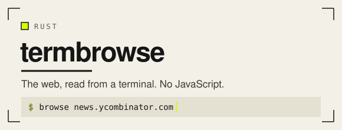
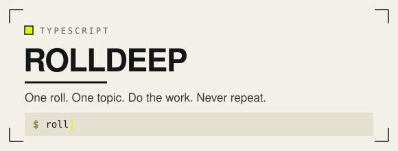
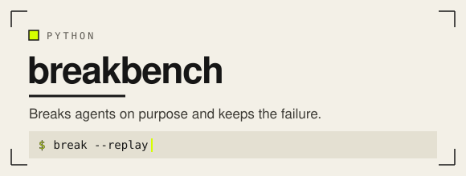
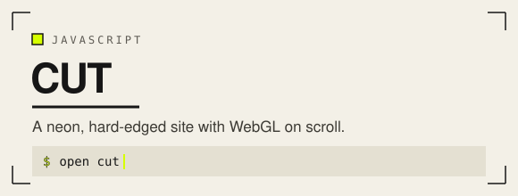
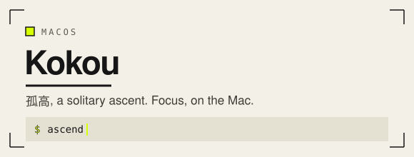
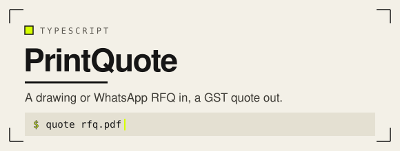

<picture>
  <source media="(prefers-color-scheme: dark)" srcset="assets/mark-dark.svg">
  <source media="(prefers-color-scheme: light)" srcset="assets/mark-light.svg">
  
</picture>

I'm Devarshee. I study computer science at RV University, and the software I finish tends to come from one irritation.

I wanted to read the web without hauling a browser along, so I built **termbrowse**. I kept opening a study app and spending the session choosing what to study, so I built **ROLLDEEP**. I got tired of agent demos that only show the run that worked, so I built **breakbench**, which fails on purpose and writes the failure down.

## Work

  <a href="https://github.com/dev-the-dev-while-deving/termbrowse"><picture><source media="(prefers-color-scheme: dark)" srcset="assets/card-termbrowse-dark.svg"></picture></a>
  <a href="https://github.com/dev-the-dev-while-deving/rolldeep-lab"><picture><source media="(prefers-color-scheme: dark)" srcset="assets/card-rolldeep-dark.svg"></picture></a>

  <a href="https://github.com/dev-the-dev-while-deving/breakbench"><picture><source media="(prefers-color-scheme: dark)" srcset="assets/card-breakbench-dark.svg"></picture></a>
  <a href="https://github.com/dev-the-dev-while-deving/cut-studio"><picture><source media="(prefers-color-scheme: dark)" srcset="assets/card-cut-dark.svg"></picture></a>

  <a href="https://github.com/dev-the-dev-while-deving/kokou"><picture><source media="(prefers-color-scheme: dark)" srcset="assets/card-kokou-dark.svg"></picture></a>
  <a href="https://github.com/dev-the-dev-while-deving/printquote-site"><picture><source media="(prefers-color-scheme: dark)" srcset="assets/card-printquote-dark.svg"></picture></a>

Also: [SmartStock](https://github.com/dev-the-dev-while-deving/SmartStocks), a Flask inventory system for a DBMS course, and [Enigma](https://github.com/dev-the-dev-while-deving/Enigma-Hackthon), a 24-hour hackathon driving agent built on a Bayesian model in PyTorch.

## Now

**Life Quest.** An Android app, Kotlin and Jetpack Compose, that turns training, routines and sleep into a game with a path, streaks and chests. Every byte stays on the phone. Not public yet.

---

Rust · TypeScript · Python · Kotlin · <a href="https://termbrowse.vercel.app">termbrowse.vercel.app</a>
