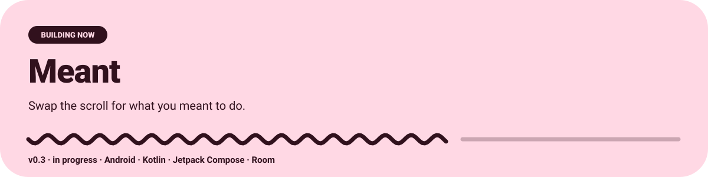
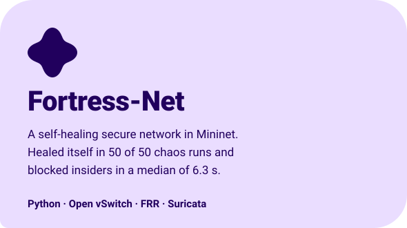
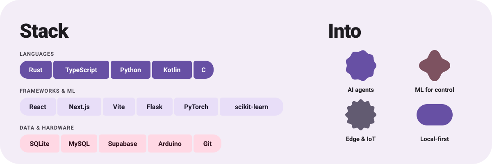
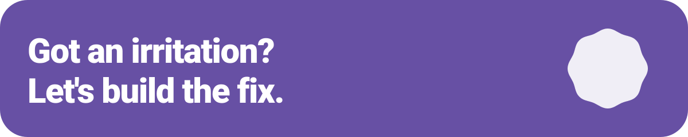

<!-- Material 3 Expressive profile. Each image has a light and a dark version that follows the viewer's GitHub theme. -->

<picture>
  <source media="(prefers-color-scheme: dark)" srcset="assets/header-dark.svg">
  
</picture>

  
  

I'm an AI engineer. Most of my projects start as a frustration: a browser that's too heavy, a study app that forces a choice, an agent demo that hides its failures. Right now I'm working on agents, small reasoning models and ML that runs on the edge.

<picture>
  <source media="(prefers-color-scheme: dark)" srcset="assets/frontier-dark.svg">
  
</picture>

## Building now

<a href="https://github.com/dev-the-dev-while-deving/meant">
  <picture>
    <source media="(prefers-color-scheme: dark)" srcset="assets/now-dark.svg">
    
  </picture>
</a>

**Latest pushes** (updated daily)

<!-- LATEST:START -->
- [**meant**](https://github.com/dev-the-dev-while-deving/meant) · Meant: swap the scroll for what you meant to do (Android) · pushed 2026-11-15
- [**MiniNet**](https://github.com/dev-the-dev-while-deving/MiniNet) · Fortress-Net: a self-healing, AI-assisted secure network built in Mininet (OVS, FRR, strongSwan, Suricata) · pushed 2026-11-08
- [**kokou**](https://github.com/dev-the-dev-while-deving/kokou) · Kokou (孤高, a solitary ascent): a focus and productivity app for the Mac. · pushed 2026-09-11
<!-- LATEST:END -->

## Things I built 

<a href="https://github.com/dev-the-dev-while-deving/termbrowse">
  <picture>
    <source media="(prefers-color-scheme: dark)" srcset="assets/termbrowse-dark.svg">
    
  </picture>
</a>

<a href="https://github.com/dev-the-dev-while-deving/Enigma-Hackthon"><picture><source media="(prefers-color-scheme: dark)" srcset="assets/enigma-dark.svg"></picture></a>
<a href="https://github.com/dev-the-dev-while-deving/breakbench"><picture><source media="(prefers-color-scheme: dark)" srcset="assets/breakbench-dark.svg"></picture></a>
<a href="https://github.com/dev-the-dev-while-deving/rolldeep-lab"><picture><source media="(prefers-color-scheme: dark)" srcset="assets/rolldeep-dark.svg"></picture></a>
<a href="https://github.com/dev-the-dev-while-deving/SmartStocks"><picture><source media="(prefers-color-scheme: dark)" srcset="assets/smartstock-dark.svg"></picture></a>
<a href="https://github.com/dev-the-dev-while-deving/cut-studio"><picture><source media="(prefers-color-scheme: dark)" srcset="assets/cut-dark.svg"></picture></a>
<a href="https://github.com/dev-the-dev-while-deving/MiniNet"><picture><source media="(prefers-color-scheme: dark)" srcset="assets/mininet-dark.svg"></picture></a>

## Writing

- [**Breaking AI agents on purpose**](writing/breaking-agents-on-purpose.md): why breakbench keeps every failure as a replayable record, and why it scores tool calls instead of words.
- [**A coding agent that proves its work**](writing/a-coding-agent-that-proves-its-work.md): nextharness, and why "tests pass" was wrong 7 times out of 12 on my hard tasks.

## Commits

<picture>
  <source media="(prefers-color-scheme: dark)" srcset="assets/shiplog-dark.svg">
  
</picture>

<picture>
  <source media="(prefers-color-scheme: dark)" srcset="https://raw.githubusercontent.com/dev-the-dev-while-deving/dev-the-dev-while-deving/output/snake-dark.svg">
  
</picture>

<picture>
  <source media="(prefers-color-scheme: dark)" srcset="https://streak-stats.demolab.com?user=dev-the-dev-while-deving&hide_border=true&border_radius=48&background=2B2930&ring=D0BCFF&fire=D0BCFF&currStreakNum=E6E0E9&sideNums=E6E0E9&currStreakLabel=D0BCFF&sideLabels=CAC4D0&dates=CAC4D0&stroke=CAC4D0">
  
</picture>

## Languages

<picture>
  <source media="(prefers-color-scheme: dark)" srcset="assets/languages-dark.svg">
  
</picture>

## Stack

<picture>
  <source media="(prefers-color-scheme: dark)" srcset="assets/stack-dark.svg">
  
</picture>

## Contact

<picture>
  <source media="(prefers-color-scheme: dark)" srcset="assets/contact-dark.svg">
  
</picture>

[GitHub](https://github.com/dev-the-dev-while-deving)
