<!-- Material 3 Expressive profile. Each image has a light and a dark version that follows the viewer's GitHub theme. -->

<picture>
  <source media="(prefers-color-scheme: dark)" srcset="assets/header-dark.svg">
  
</picture>

  
  

I'm an AI engineer. Most of my projects start as a frustration: a browser that's too heavy, a study app that forces a choice, an agent demo that hides its failures. Right now I'm working on agents, small reasoning models and ML that runs on the edge.

<picture>
  <source media="(prefers-color-scheme: dark)" srcset="assets/frontier-dark.svg">
  
</picture>

## Flagship: Paidva, a research agent that shows its work

<a href="https://github.com/dev-the-dev-while-deving/paidva-research-agent">
<picture>
  <source media="(prefers-color-scheme: dark)" srcset="assets/paidva-dark.svg">
  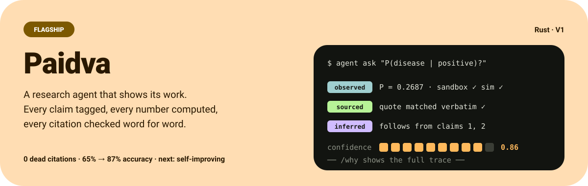
</picture>
</a>

Ask most AI research tools a question and you get a confident paragraph with links. Some links don't support the claim, the "95% sure" means nothing, and nobody checked the maths. **Paidva** is my answer to that. It's a Rust agent where **the model proposes and code decides**:

- **Every claim is tagged** `observed` · `sourced` · `inferred` · `knowledge` · `speculation`, so you can see where each sentence came from.
- **Every number is computed** in a sandboxed Python run and cross-checked against simulation, never recalled from memory.
- **Every citation is verified**: the quote must appear word for word in the source, and a separate checker must agree it supports the claim.
- **Every answer gets a confidence score you can rank by**, and false premises get flagged instead of answered.

**First eval round** (same model, alone vs. inside Paidva): on qwen3.8-27b, accuracy went from 65% to 87%, calibration error from 0.34 to 0.13, and dead citations went to zero across every run. The answers it was most confident about were right 80% of the time on the hard set, versus 38% for the plain model. The sample is still small, so these results aren't significant yet, and the write-up says so.

**Where it's going:** V1 proves the system beats the bare model. V2 has the agent propose its own improvements from its failures, and tests a reasoning layer built on Nyaya logic (*pramana* evidence types and *hetvabhasa* fallacy checks). V3 asks whether a small agent can **keep improving itself round after round** instead of stalling after one gain.

**[→ Read the code and try it](https://github.com/dev-the-dev-while-deving/paidva-research-agent)** · Rust · free-tier open-weight models · $0/month · open source (AGPL-3.0)

## Building now

<a href="https://github.com/dev-the-dev-while-deving/meant">
  <picture>
    <source media="(prefers-color-scheme: dark)" srcset="assets/now-dark.svg">
    
  </picture>
</a>

**Latest pushes** (updated daily)

<!-- LATEST:START -->
- [**paidva-research-agent**](https://github.com/dev-the-dev-while-deving/paidva-research-agent) · Paidva: a research and statistics agent that shows its work. Tagged claims, sandboxed maths, verified citations, confidence you can rank by. Rust · free-tier models · AGPL-3.0. · pushed 2026-11-22
- [**meant**](https://github.com/dev-the-dev-while-deving/meant) · Meant: swap the scroll for what you meant to do (Android) · pushed 2026-11-15
- [**MiniNet**](https://github.com/dev-the-dev-while-deving/MiniNet) · Fortress-Net: a self-healing, AI-assisted secure network built in Mininet (OVS, FRR, strongSwan, Suricata) · pushed 2026-11-08
<!-- LATEST:END -->

<picture>
  <source media="(prefers-color-scheme: dark)" srcset="assets/built-dark.svg">
  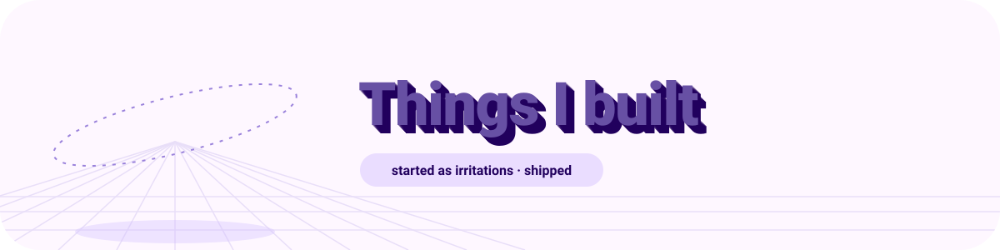
</picture>

<a href="https://github.com/dev-the-dev-while-deving/termbrowse">
  <picture>
    <source media="(prefers-color-scheme: dark)" srcset="assets/termbrowse-dark.svg">
    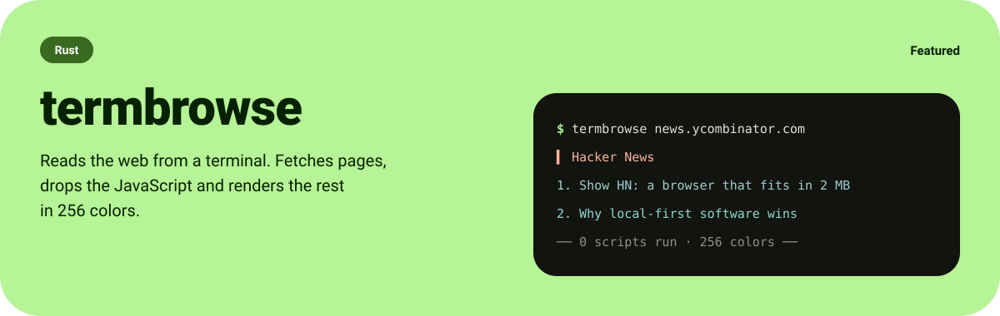
  </picture>
</a>

<a href="https://github.com/dev-the-dev-while-deving/Enigma-Hackthon"><picture><source media="(prefers-color-scheme: dark)" srcset="assets/enigma-dark.svg">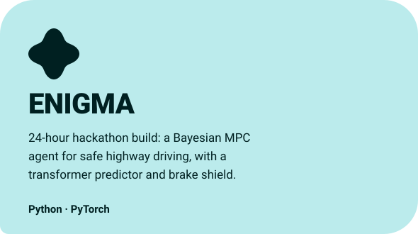</picture></a>
<a href="https://github.com/dev-the-dev-while-deving/breakbench"><picture><source media="(prefers-color-scheme: dark)" srcset="assets/breakbench-dark.svg">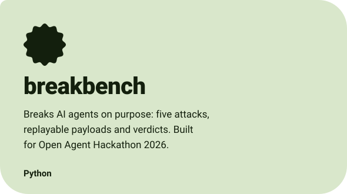</picture></a>
<a href="https://github.com/dev-the-dev-while-deving/rolldeep-lab"><picture><source media="(prefers-color-scheme: dark)" srcset="assets/rolldeep-dark.svg">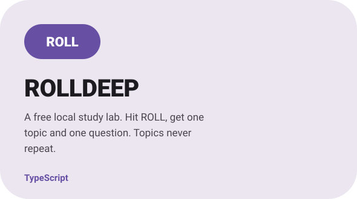</picture></a>
<a href="https://github.com/dev-the-dev-while-deving/SmartStocks"><picture><source media="(prefers-color-scheme: dark)" srcset="assets/smartstock-dark.svg">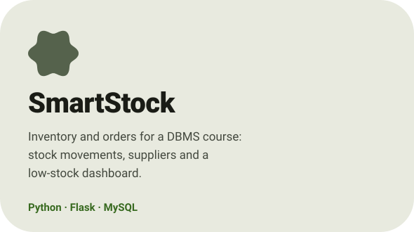</picture></a>
<a href="https://github.com/dev-the-dev-while-deving/cut-studio"><picture><source media="(prefers-color-scheme: dark)" srcset="assets/cut-dark.svg">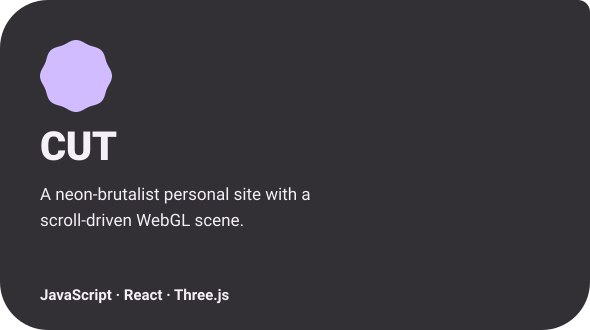</picture></a>
<a href="https://github.com/dev-the-dev-while-deving/MiniNet"><picture><source media="(prefers-color-scheme: dark)" srcset="assets/mininet-dark.svg"></picture></a>

## Writing

- [**Breaking AI agents on purpose**](writing/breaking-agents-on-purpose.md): why breakbench keeps every failure as a replayable record, and why it scores tool calls instead of words.
- [**A coding agent that proves its work**](writing/a-coding-agent-that-proves-its-work.md): nextharness, and why "tests pass" was wrong 7 times out of 12 on my hard tasks.

## Commits

<picture>
  <source media="(prefers-color-scheme: dark)" srcset="assets/skyline-dark.svg">
  
</picture>

<picture>
  <source media="(prefers-color-scheme: dark)" srcset="assets/shiplog-dark.svg">
  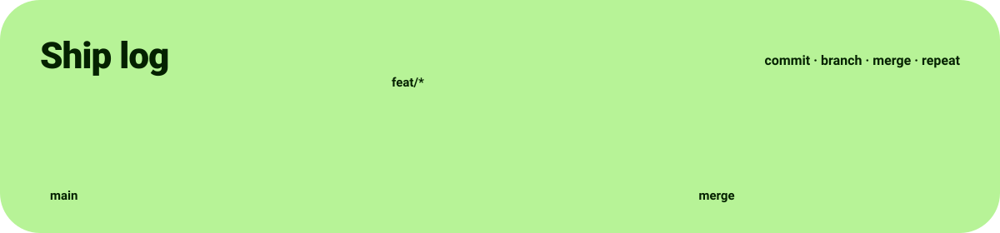
</picture>

<picture>
  <source media="(prefers-color-scheme: dark)" srcset="https://streak-stats.demolab.com?user=dev-the-dev-while-deving&hide_border=true&border_radius=48&background=282B24&ring=9CD67D&fire=9CD67D&currStreakNum=E2E4D9&sideNums=E2E4D9&currStreakLabel=9CD67D&sideLabels=C3C8BB&dates=C3C8BB&stroke=C3C8BB">
  
</picture>

## Languages

<picture>
  <source media="(prefers-color-scheme: dark)" srcset="assets/languages-dark.svg">
  
</picture>

## Stack

<picture>
  <source media="(prefers-color-scheme: dark)" srcset="assets/stack-dark.svg">
  
</picture>

## Contact

<picture>
  <source media="(prefers-color-scheme: dark)" srcset="assets/contact-dark.svg">
  
</picture>

[GitHub](https://github.com/dev-the-dev-while-deving)
